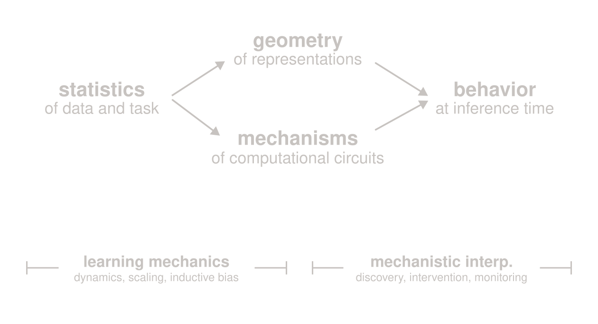

import datesUrl from '../_media/residualstream/dates.js?url'
import datesDataUrl from '../_media/residualstream/dates-pca.json?url'

At ICML this year, I was invited to give a short talk at the mechanistic interpretability workshop. I gave a pretty speculative talk, it was fun! Here are its contents, abridged and edited.

A central premise of [learning mechanics](https://arxiv.org/abs/2604.21691) is that understanding the dynamics of model training is not just useful, but *necessary* for producing a full mechanistic understanding of LLM intelligence.
Recently, I've been focused on geometric structures that arise in the residual stream, including linear representational subspaces, curved feature manifolds, latent graphs, posteriors on a simplex, etc.
I think it's important to deeply understand this vibrant zoology.
The reason it's important is that the residual stream is a stage on which high-dimensional geometric operations are performed; therefore these residual stream structures are likely the substrates of forward pass computations.
At the same time, they are also the artifacts of pretraining and finetuning, so we can't expect to understand their origin without concurrently understanding the dynamics of the optimization and how they are driven by the character of the training data.

<figure class="dates-figure">

<figcaption>
I pass twenty date-related prompts through [OLMo 3 7B base model](https://huggingface.co/allenai/Olmo-3-1025-7B), e.g. "Today is my birthday, 14 March", for every date of the year. For each date, I collect the final-token residual stream vectors, average over the prompts, and then projected the 365 resulting vectors onto their top three principal components. The toggles change how the date is formatted in each prompt; day-first representations respect the calendar geometry, whereas writing "March 14" makes the numerical value of the day dominate the geometry. Magically, ending the prompt with a period fixes this.

</figcaption>
</figure>

In some recent work, I along with some excellent collaborators focused on a bite-sized problem: understanding the origin, universality, and computational role of continuous feature manifolds.
What we prove is that the manifolds are a direct consequence of a symmetry structure inherent in the pairwise statistics of natural language. We do this by:

1. Empirically verifying that the symmetry structure is legit (real data really has this structure).
2. Establishing an ansatz to describe learning — we propose that language models encode these statistics via inner products of representation vectors. (This ansatz is motivated by the fact that this is literally the `word2vec` learning rule.)
3. Using [the solution of this learning problem](../qwem/) (it's basically PCA) and showing that the feature manifolds fall out naturally from the symmetry.

One way to think of our approach is that we're using `word2vec` as a "Hydrogen atom" of language modelling: complicated enough to be interesting and predictive, simple enough to be solvable.
The solution is given in terms of the pairwise statistics of the data, which we know has the circulant symmetry structure. Thus we can prove that the representations form smooth, Fourier-like manifolds. In fact, we show how to analytically derive the parametric equations for these manifolds in many realistic cases. We extract as corollaries some nice computational properties of these manifolds, like the ease of decoding spatial maps and historical timelines from the learned representations using only linear probes.

That's a whirlwind tour of our technical result; you can [check out the paper](https://arxiv.org/abs/2602.15029) for more details.
For the remainder of the post, I want to step back and assess our strategy, and highlight some general lessons one could take away.

The angle of attack in this project was to identify a simple setting in which we can directly solve the training dynamics.
This allows us to directly identify the causal link between the statistics of the data and the learned representational structure.
Here's a visual representation, which reflects how I generally mentally decompose the subtasks of LLM interpretability:

There is a clear causal structure: during pretraining, repeated washes of forward and backward passes burns in the statistics of the data and task into the model weights, producing these geometric structures in the residual stream and computational circuits that exploit them.
In my mind, this process is the purview of learning mechanics.
Then, at inference time, geometric structure in the representations and circuits in the weights interact to produce intelligence. Understanding this interaction is one of the main charges of mechinterp.
To understand the origin of model intelligence — well enough to reliably monitor and effectively intervene — we need both research efforts to work in tandem, providing insights to each other and converging on a useful theory of language modeling.

I'll conclude by showing a few successful examples of this synergy, although as a disclaimer, this is an unfair, incomplete, and totally biased picture of the scientific history here.

1. [Nanda _et al._ (2023)](https://arxiv.org/abs/2301.05217) and related work in mechinterp discovered the Fourier algorithm for modular arithmetic. [Kunin _et al._ (2025)](https://arxiv.org/abs/2506.06489) and related work in learning mechanics-y fields show how this algorithm emerges from cyclic symmetry in the task statistics.
2. [Merullo _et al._ (2023)](https://arxiv.org/abs/2305.16130) and related work show that language models use `word2vec`-style vector arithmetic in the residual stream for analogical reasoning. [Korchinski _et al._ (2025)](https://arxiv.org/abs/2505.18651) show how this linear structure emerges from $\mathbb Z_2$ structure in language statistics.
3. [Engels _et al._ (2025)](https://arxiv.org/abs/2405.14860) discovered circular feature manifolds in LLM representations. [Karkada _et al._ (2026)](https://arxiv.org/abs/2602.15029) show how these manifolds emerge from translation symmetry in language statistics.

Despite the strong skew towards works that I'm most familiar with, I think the message is directionally correct: a full end-to-end understanding of how particular intelligent behaviors arise can be driven by collaboration between learning mechanics and mechanistic interpretability.
So, my call to action is: theoretical and empirical mechinterp researchers should diligently organize joint [research expeditions](../mapmaking/), so that we can quickly progress towards more complete scientific maps of LLM intelligence.